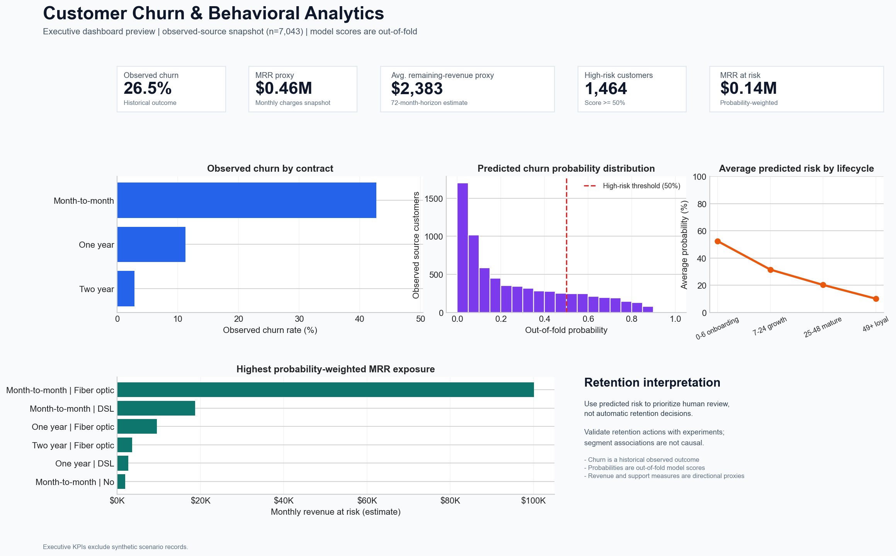

# Customer Churn & Behavioral Analytics

[](https://www.python.org/)
[](https://github.com/edsele/customer-churn/actions/workflows/ci.yml)
[](https://docs.astral.sh/ruff/)
[](LICENSE)

An end-to-end customer churn analytics project built around a validated Python
pipeline, a SQLite analytics mart, reusable SQL analysis, and native Power BI
plus Tableau-ready dashboard outputs. It is designed to answer two practical retention questions:
which segments deserve investigation, and which accounts should be reviewed
first for a retention intervention.

| Capability | Current implementation |
|---|---|
| Data engineering | Validated raw ingestion, cleaning, feature documentation, lineage, and audit reports |
| Analysis | Reproducible EDA figures and 14 reusable SQLite queries |
| Machine learning | Three Scikit-Learn classifiers, training-only tuning, stratified holdout validation, and out-of-fold scoring |
| Decision support | Native Power BI executive report, model-estimated MRR exposure, SQL/Tableau-ready high-risk worklist, and Tableau specifications |



*Static Python preview from the scored export. The native Power BI report is
linked below; Tableau materials in [`dashboard/`](dashboard/) are build
specifications, not a published workbook.*

## Power BI dashboard

The repository includes a native Power BI Desktop report:
[`Customer_Churn_Analytics.pbix`](dashboard/powerbi/Customer_Churn_Analytics.pbix).
Its executive page embeds 7,043 observed, scored customer records and includes
KPI cards, churn by contract, a predicted-risk distribution, revenue-at-risk by
contract, and interactive Contract and Internet Service slicers. The embedded
data opens immediately; refresh it from a new pipeline run before sharing. The
reproducible source and refresh guidance are in
[`dashboard/powerbi/`](dashboard/powerbi/).

## Results at a glance

The latest verified local run selected Gradient Boosting by training-only
cross-validated ROC-AUC, then evaluated it once on an untouched, stratified 20%
holdout of the observed source customers.

| Holdout metric | Result |
|---|---:|
| Accuracy | 80.77% |
| Precision | 67.82% |
| Recall | 52.41% |
| F1 | 59.13% |
| ROC-AUC | **84.72%** |
| Average precision | 66.61% |

| Candidate model (training-CV mean) | Accuracy | Precision | Recall | F1 | ROC-AUC |
|---|---:|---:|---:|---:|---:|
| Logistic Regression | 80.74% | 67.29% | 53.38% | 59.48% | 84.74% |
| Random Forest | 76.93% | 54.73% | **75.85%** | **63.56%** | 84.66% |
| Gradient Boosting | 80.74% | 67.45% | 53.18% | 59.43% | **84.99%** |

The model is intended for risk ranking and human-led review, not automatic
retention decisions. Full results, calibration, confusion matrix, precision-
recall curve, and holdout permutation importance are available in
[`reports/model_evaluation.md`](reports/model_evaluation.md).

## Business problem

Customer churn reduces recurring revenue and raises acquisition costs. A
retention team needs more than a headline churn rate: it needs a consistent way
to identify at-risk segments, estimate revenue exposure, and evaluate whether
an intervention changes outcomes.

This project answers:

1. Which customer, contract, service, and payment segments exhibit the highest observed churn?
2. Which snapshot attributes are most useful for ranking churn risk?
3. Where is probability-weighted monthly revenue exposure concentrated?
4. How should historical outcomes, model scores, and engineered proxies be distinguished in reporting?

## Data scope and provenance

The raw input is the IBM Telco Customer Churn sample: a cross-sectional snapshot
of 7,043 customers with 21 columns and a historical `Churn` outcome.

| Attribute | Detail |
|---|---|
| Source | [IBM Telco Customer Churn](https://github.com/IBM/telco-customer-churn-on-icp4d) |
| Observed customers | 7,043 |
| Target | `Churn` (`Yes`/`No` in raw data; encoded `1`/`0` after cleaning) |
| Observed churn prevalence | 26.54% |
| Raw file checksum | Canonical SHA-256 (LF-normalized) `16320C9C1EC72448DB59AA0A26A0B95401046BEF5D02FD3AEB906448E3055E91` |
| Optional analytics scenario | 21,000 rows: 7,043 observed plus 13,957 lineage-labeled scenario descendants |

The source does not independently contain 20,000 customers. The optional
scenario is clearly marked with `record_source` and `source_customer_id`, and
is used for dashboard and SQL prototyping only. It is excluded from model
training, model evaluation, executive KPIs, and observed-source EDA findings.
The checksum is calculated after normalizing CRLF line endings to LF, which
makes it stable across standard Git checkouts. Read the [data card](data/README.md)
for handling and limitations, and the [third-party notice](THIRD_PARTY_NOTICES.md)
for source and license references.

## Key EDA findings

The following findings use only the 7,043 observed source records:

- Overall observed churn is **26.5%**.
- Month-to-month customers have the highest observed churn (**42.7%**).
- Fiber-optic customers show **41.9%** observed churn, and electronic-check
  customers show **45.3%**.
- Customers in their first six months show **52.9%** observed churn, compared
  with **14.0%** for customers beyond 24 months.
- Holdout permutation importance is led by tenure, contract type, and internet
  service. These are prioritization signals, not causal claims.

The generated summary and figures are available in
[`reports/eda_summary.md`](reports/eda_summary.md) and
[`reports/figures/`](reports/figures/).

## Architecture

```text
IBM Telco customer snapshot (7,043 observed records)
                         |
                         v
             schema validation and cleaning
                         |
          +--------------+----------------------+
          |                                     |
          v                                     v
observed clean data                 lineage-labeled 21K scenario
          |                          (SQL and dashboard prototype)
          |                                     |
          +---------------+---------------------+
                          |
                          v
            documented feature engineering
                          |
                          v
       observed-only train/CV/holdout and model selection
                          |
                          v
       source-aware out-of-fold scoring of the analytics scenario
                          |
          +---------------+---------------------+
          |                                     |
          v                                     v
observed-source EDA and model evidence    SQLite mart and dashboard exports
```

## Quick start

### 1. Create an environment

```bash
cd customer-churn
python -m venv .venv

# macOS / Linux
source .venv/bin/activate

# Windows PowerShell
# .venv\Scripts\Activate.ps1

python -m pip install --upgrade pip
python -m pip install -r requirements.txt
```

For the direct dependency versions used to verify this repository, install
[`requirements.lock`](requirements.lock) instead of `requirements.txt`.

### 2. Build all artifacts

```bash
python run_pipeline.py
```

The pipeline:

1. loads, validates, and cleans the raw customer snapshot;
2. creates the lineage-labeled scenario and data-quality audit;
3. engineers documented customer features;
4. tunes Logistic Regression, Random Forest, and Gradient Boosting on observed training folds only;
5. evaluates the selected model once on the untouched observed holdout;
6. creates out-of-fold probabilities for each source profile and its scenario descendants;
7. writes the SQLite mart, SQL-ready views, Tableau export, observed-only Power BI export, figures, reports, and portable preview.

For a fast validation and EDA smoke run without fitting models:

```bash
python run_pipeline.py --skip-training
```

This leaves the scored SQLite mart and Power BI/Tableau exports unchanged. Run
the full pipeline before reviewing or sharing model, SQL, or dashboard results.

### 3. Verify quality checks

```bash
python -m ruff check .
python -m pytest -q
python run_sql.py
```

## Project structure

```text
customer-churn/
|-- config/                 # paths, data validation, augmentation, and model settings
|-- data/
|   |-- raw/                # IBM source CSV
|   |-- processed/          # generated clean, feature, score, and SQLite artifacts
|   `-- exports/            # generated Tableau-ready customer export
|-- dashboard/              # Power BI report, Tableau guide, calculations, storyboard, preview
|-- docs/                   # technical and reporting notes
|-- models/                 # generated fitted pipelines
|-- reports/                # EDA, evaluation, quality, and run-manifest evidence
|-- sql/                    # mart DDL plus 14 reusable analytics queries
|-- src/                    # modular pipeline code
|-- tests/                  # unit and integration tests
|-- run_pipeline.py         # full pipeline CLI
|-- run_sql.py              # SQL query runner
|-- requirements.txt        # supported dependency ranges
|-- requirements.lock       # direct pins used for the verified environment
`-- pyproject.toml          # package metadata and tool configuration
```

## Pipeline design

| Module | Responsibility |
|---|---|
| [`src/preprocessing.py`](src/preprocessing.py) | Schema, range, type, target-label, duplicate-ID, and scenario-distribution validation; cleaning and lineage. |
| [`src/feature_engineering.py`](src/feature_engineering.py) | Documented feature creation and fold-safe categorical/numeric preprocessing. |
| [`src/modeling.py`](src/modeling.py) | Stratified and group-aware validation, tuning, model selection, persistence, and out-of-fold dashboard scoring. |
| [`src/evaluation.py`](src/evaluation.py) | Classification metrics, ROC/PR/calibration plots, confusion matrix, and holdout permutation importance. |
| [`src/database.py`](src/database.py) | SQLite customer and prediction tables, integrity constraints, reporting views, and Tableau and Power BI exports. |
| [`src/eda.py`](src/eda.py) | Repeatable observed-source EDA figures and values-driven summary. |
| [`src/dashboard_preview.py`](src/dashboard_preview.py) | Portable executive preview using observed source records by default. |

Each full run writes [`reports/run_manifest.json`](reports/run_manifest.json)
with the canonical raw-data checksum, configuration checksum, Python and package
versions, Git revision, and `git_dirty_before_run` working-tree state captured
before pipeline outputs are generated.

## Feature engineering

| Feature | Purpose | Model input? |
|---|---|---|
| `tenure_bucket` | Groups customers into onboarding, growth, mature, and loyal stages. | Yes |
| `revenue_per_month` | Uses realized charges per tenure month; defaults to monthly charge for new customers. | Yes |
| `service_count` | Counts active service subscriptions. | Yes |
| `customer_engagement_score` | Explainable service, security, tenure, and contract composite. | Yes |
| `payment_risk_flag` | Electronic-check indicator. | Yes |
| `contract_risk_score` | Reporting-only contract flexibility indicator. | No |
| `lifetime_value_estimate` | `MonthlyCharges x max(72 - tenure, 0)`: a 72-month-horizon remaining-revenue proxy. | No |
| `support_ticket_proxy` | Estimated support-contact proxy; not an observed ticket count. | No |

The full feature contract and intended-use boundary are generated in
[`reports/feature_engineering.md`](reports/feature_engineering.md). The support
proxy is intentionally dashboard-only and should be replaced by real CRM or
support data in a production system.

## Machine learning methodology

- **Population:** only the 7,043 observed IBM customer snapshots.
- **Holdout:** deterministic 20% stratified partition of observed records;
  source profiles are kept together if they repeat.
- **Tuning:** five-fold stratified cross-validation on training records only,
  with source groups preserved if a source profile repeats, and ROC-AUC as the
  selection metric.
- **Preprocessing:** a Scikit-Learn `ColumnTransformer` inside each candidate
  pipeline with median/most-frequent imputation, standard scaling, and one-hot
  encoding.
- **Models:** Logistic Regression, Random Forest, and Gradient Boosting.
- **Final evaluation:** a single evaluation on the untouched observed holdout.
- **Dashboard scoring:** five-fold out-of-fold probabilities so a source record
  is scored by a model that did not train on it.

The configured high-risk threshold is 0.50, matching the evaluation report.
In a real retention workflow, threshold selection should reflect contact
capacity, intervention cost, and measured campaign uplift.

## SQL analytics

The SQLite mart has two base tables:

- `customers`: feature-engineered customer snapshot with unique `customerID`;
- `customer_predictions`: constrained one-row-per-customer score contract.

`sql/00_create_views.sql` creates the canonical customer analytics view,
customer segments, high-risk worklist, and a cross-sectional retention snapshot.
The remaining 14 query files cover churn by segment, contract revenue, tenure,
high-risk groups, MRR exposure, payment methods, demographics, support-proxy
segments, value segments, scoring coverage, and executive KPIs.

```bash
# Run every analytical query after the pipeline completes
python run_sql.py

# Run one query
python run_sql.py --query 04_high_risk_customer_groups.sql
```

Queries preserve `record_source` so scenario rows cannot be confused with
observed source customers. The runner returns a non-zero exit code if any query
fails.

## Tableau handoff

The pipeline exports `data/exports/tableau_dashboard_data.csv` with observed
outcomes, out-of-fold probabilities, risk bands, revenue-at-risk estimates,
customer lifecycle fields, and source lineage.

The repository includes a professional build package:

- [Tableau build guide](dashboard/README.md)
- [Calculated fields](dashboard/CALCULATED_FIELDS.md)
- [Dashboard storyboard](dashboard/DASHBOARD_STORYBOARD.md)

It specifies an Executive Summary, Churn Drivers and Segments, and a Retention
Action Queue with filters for contract, service, payment method, age group,
tenure, risk band, and source provenance. Executive and driver views use
`record_source = observed` by default. The scenario may be used in a separately
labeled prototype view.

No `.twb` or `.twbx` workbook is checked in. Build and verify the interactive
workbook in Tableau Desktop or Tableau Public before claiming a published
Tableau dashboard; then add exported workbook screenshots and a public link to
this section.


## Limitations and next steps

- Replace the scenario with a larger independently observed labeled source
  before making claims about 20,000 real customers.
- Add actual CRM, support, billing-event, and campaign-response data.
- Introduce temporal validation after obtaining churn-event dates.
- Calibrate the operating threshold with intervention cost, capacity, and uplift.
- Treat probability-weighted MRR exposure as a model-estimated prioritization
  proxy until probabilities are calibrated and validated on a future period.
- Add data contracts, drift monitoring, scheduled orchestration, and access
  controls for a production deployment.
- Use treatment-effect modeling after collecting randomized retention outcomes.

## License

Project code is available under the [MIT License](LICENSE). Dataset use remains
subject to the upstream terms identified in the [data card](data/README.md) and
[third-party notice](THIRD_PARTY_NOTICES.md).
